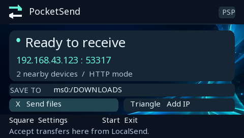

# PocketSend PSP — 0.2 experimental HTTP build

A native PSP homebrew app implementing the LocalSend v2 protocol. Intended first
test device: PSP-3006, Sony 6.61 with ARK-5 and cIPL, using a phone hotspot.
An independent implementation; not an official LocalSend release.

[Download v0.2](https://github.com/caesarium25/PocketSend-PSP/releases/tag/v0.2) · [Installation](#install-and-first-test)



## Status

An actual PSP `EBOOT.PBP` is included in the install ZIP on the Releases page. It compiles successfully with PSP GCC
15.2.0, with no compiler or import-fixup warnings in the final build.
70 automated checks pass: 44 for names, paths, metadata, limits, query handling
and SHA-256; 26 for HTTP framing, fragmented input, chunked bodies and truncation.

**It has not yet been launched on a physical PSP or tested against a running
LocalSend app.** These are source-level and native host checks, not hardware
certification. The first launch and transfer test are still necessary.

## Install and first test

1. Extract the install ZIP onto the Memory Stick root. The resulting path must
   be `ms0:/PSP/GAME/PocketSend/EBOOT.PBP`.
2. Connect your PSP to the phone hotspot using its existing saved network profile.
   Launch **PocketSend PSP** from Game → Memory Stick, then
   select that profile inside the app. No firmware change is required.
3. Open LocalSend on your phone. For this prototype, disable LocalSend's
   encryption setting. Transfers use HTTP; use your trusted hotspot or LAN.
4. Keep the PSP on **Ready to receive**. Try sending a small, disposable text
   file first. Select **PocketSend PSP** in LocalSend. If it does not appear,
   use LocalSend's manual IP option with the address displayed on the PSP,
   port **53317**.
5. On the PSP, choose a folder and accept. Confirm the file is present and has
   the expected contents. Then try sending a file from the PSP back to the phone.

The hotspot must allow the phone and PSP to communicate. Automatic discovery
uses multicast, which some hotspots block; manual IP can bypass discovery but
cannot bypass hotspot client isolation. Keep the phone app in the foreground
during the initial test.

## Features implemented

- Receive and send batches of up to 32 flat files.
- UDP multicast discovery and LocalSend registration; manual IPv4 and custom port.
- Destination selection, directory navigation, and new-folder creation.
- Up to eight editable favorite folders, including MUSIC, PICTURE, VIDEO and DOWNLOADS.
- Remembered destination; optional media-folder suggestion for the incoming batch.
- Overwrite confirmation and a free-space check before accepting.
- File and batch byte progress, speed and estimated remaining time.
- Temporary `.part` files; complete files are renamed into place. An existing
  file is retained until the replacement is completely received and checked.
- Verification when the sender supplies SHA-256; received bytes stream in 32 KiB buffers.
- Cancellation, file-format notes, and optional automatic screen dimming using
  the PSP's configured display idle timer while preventing system sleep.
- Both Content-Length and HTTP chunked bodies can be received.
- Receiver PIN entry when sending to a device that requires one.

## Interface

The interface is drawn at the PSP native 480 × 272 resolution, with embedded
Noto Sans type at 15 px for body text, 18 px for titles, and 26 px for status.
Lists show five rows; selected long names and paths scroll horizontally. Dark
panels keep text readable over the cyan wallpaper. Matching launcher icon and
background are embedded in EBOOT.PBP. The `previews` folder contains host renders
from the production drawing code, not photographs or emulator captures.

To regenerate artwork exports and embedded font masks, install Pillow then run
`python tools/prepare_assets.py`. See `assets/ART-DIRECTION.md` for the wallpaper
prompt and `assets/FONT-LICENSE.txt` for the bundled Noto Sans OFL license.

## Controls

| Screen | Controls |
|---|---|
| Home | X: send; Triangle: add IP; Square: settings; Start: exit; O: cancel pending incoming batch |
| Incoming request | X: accept; O: reject; Triangle: choose folder; Square: suggest a media folder; R: review files |
| Folder/file browser | D-pad: move; X: open folder or mark/unmark file; O: parent/back; Start: choose folder or send selected files |
| Browser extras | Triangle: favorites; L: new folder; R: add current folder to favorites; Select: cancel; Square: controls help |
| Favorites | X: open; Square: remove favorite; O: back |
| Text entry | D-pad: move; X: add character; Square: delete; Start: finish; O: cancel |
| Transfer | O: cancel |

File selections persist while navigating within one send operation. A SELECTED badge
shows selected files. Folder names and IP addresses use a built-in keyboard.

## Current limits and recovery

- HTTP only. HTTPS/TLS and resume support are deferred. Session tokens do not
  provide encrypted or cryptographically authenticated transfers.
- Maximum file size: 2,147,483,647 bytes; maximum 32 files per request.
- Flat files only: directory trees in a transfer request are rejected. Save
  backups can be sent as selected files, not automatically packaged folders.
- One socket is serviced at a time. Uploads queued by a parallel sender are
  processed sequentially; large parallel batches need hardware validation.
- Receiving is serviced from the home screen and device-selection screen.
  Return home from settings or the file browser before sending from your phone.
- Receive approval expires after two minutes; an idle accepted batch expires
  after five minutes. An incomplete transfer times out after 30 seconds without
  data. A sender cancellation while the approval dialog is open may require O
  on the PSP or expiration of the dialog.
- Names render in ASCII; non-ASCII filenames may display as question marks.
  Folder listings show up to 512 entries and limit path lengths.
- Transferring a media file does not convert it into a PSP-compatible format.
- Normal cancellation removes the partial file. Power loss can leave a
  `filename.<token>.part` or `.backup` file. Inspect these before removal:
  a `.backup` may hold the original if power failed during replacement.
- Batch cancellation preserves files already completed successfully.
- Settings are stored in `settings.json` beside EBOOT.PBP. Delete that file
  while the app is closed to reset defaults.

## Build from source

With an existing [PSPDEV toolchain](https://github.com/pspdev/pspdev):

```sh
make
```

Or, without make:

```sh
python build.py /path/to/pspdev
```

The supplied binary was built using
[pspdev-win v2](https://github.com/dmang-dev/pspdev-win/releases/tag/v2).
Its downloaded toolchain ZIP SHA-256 was checked against the release manifest:
`037f902acd90cfcf4711aeee6462479a6d0eabee6faf93ff44fe1081e653d512`.
Toolchains and compiler executables are not included in this source package.

## Tests

With a native C compiler:

```sh
cc -std=gnu99 -Isrc tests/test_core.c src/core.c src/cJSON.c src/sha256.c -lm -o test_core
./test_core
```

The HTTP test compiles the production parser/decoder function bodies with an
in-memory fragmented transport, using [Zig](https://ziglang.org/) as the native
C compiler. It checks HTTP logic, not PSP sockets or Wi-Fi:

```sh
python tests/test_http.py /path/to/zig
```

Optional hardware smoke test, from a computer on the same network:

```sh
python tests/psp_smoke.py 192.168.43.123
python tests/psp_smoke.py 192.168.43.123 --send example.txt
python tests/psp_smoke.py 192.168.43.123 --send example.txt --chunked
```

Replace the example IP with the PSP's displayed address. Sending still requires
acceptance on the PSP. The script supplies SHA-256 so the PSP checks received bytes.

Hardware acceptance checks: launch; connect; discover; add IP in both directions;
small send/receive; two-file batch; zero-byte file; folder create/favorites; decline;
overwrite decline/accept; cancel a larger transfer; disable hotspot mid-transfer;
verify completed files and absence of normal-cancellation partial files; dim/wake.

## References and credits

- [LocalSend protocol](https://github.com/localsend/protocol), v2.2 documentation.
- [LocalSend source](https://github.com/localsend/localsend), inspected at commit
  `d01fdb14c978fa8b2b13e29a50cc0feaefe5c1b9` for interoperability behavior.
- [PSPSDK](https://github.com/pspdev/pspsdk) networking, input, display and file APIs.
- [cJSON 1.7.19](https://github.com/DaveGamble/cJSON/tree/v1.7.19), MIT; license included.
- [Brad Conte's SHA-256](https://github.com/B-Con/crypto-algorithms), public domain;
  unsigned casts added to avoid undefined signed shifts, checked against standard vectors.

Original PocketSend source is provided under the included MIT license.
